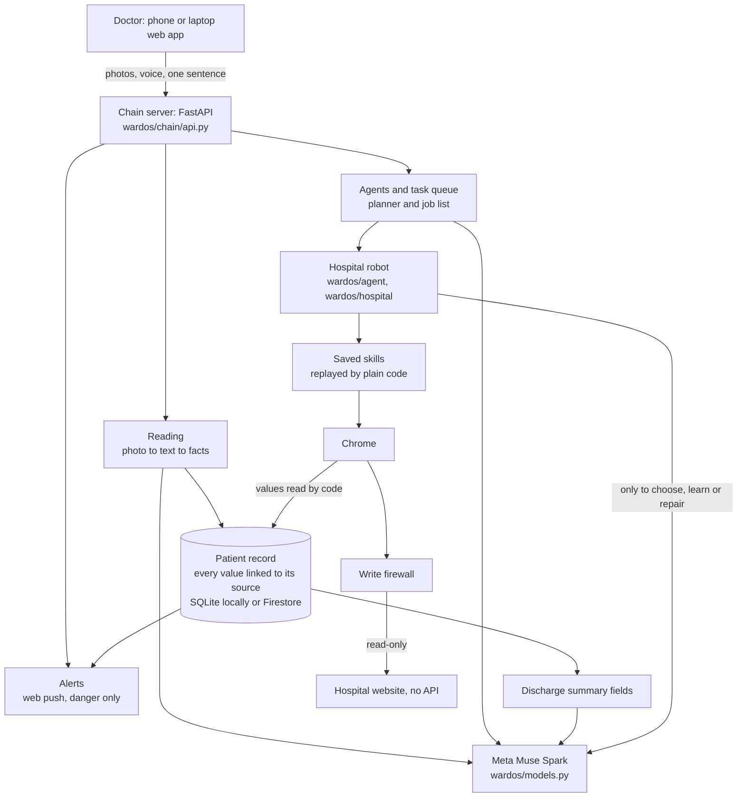

# WardOS

**An agentic OS that handles a patient's paperwork from admission to discharge, for hospitals that still run on paper.**

[Demo video](VIDEO_LINK_PLACEHOLDER) · [Live guest demo (no login, names changed)](https://wardos-chain-yoo4mmceqq-el.a.run.app/demo/start?fresh=1)

Built by a doctor at AIIMS Rishikesh, one of India's flagship government hospitals. Powered by Meta Muse Spark.

## The problem

Most hospital AI runs on electronic records. Most hospitals in developing countries don't have them. Even at AIIMS, every note and ward round is written by hand.

So the doctor becomes the API:

- Lab reports sit behind a government website with a CAPTCHA and an OTP, one patient at a time.
- Facts are scattered across a thick paper file.
- One discharge summary takes 40-60 minutes to type by hand.

## How WardOS helps

The doctor photographs the file and speaks or types what they need. WardOS keeps one living record for each patient, does the website work, and writes the summary. A doctor always checks and decides.

| | |
|---|---|
| **Reads** | A photo of a paper file becomes a structured record: labs by date, medicines and plan. Every number links to its source photo. |
| **Asks** | Ask a plain-language question about a patient and get an answer with the entries it used. |
| **Works** | One sentence starts hospital-website jobs. A robot browser signs in, finds the reports and reads the values with code. |
| **Learns** | A new job is worked out once by Meta Muse Spark and saved as a reusable skill. Later runs replay it without a model. |
| **Writes** | One click fills the discharge summary form from the record, using Muse Spark and a separate summary service. |
| **Watches** | Overnight watches keep checking a test and alert only on danger. |

## How Meta AI is used

All model calls in WardOS are Muse Spark. They go through one class, `MuseClient` in `wardos/models.py`: HTTPS requests to the Meta Model API (`/responses`). The default model is `muse-spark-1.3-contributor` at effort `high`. Set it with `WARDOS_MUSE_MODEL` and `WARDOS_MUSE_EFFORT`.

| Job | Input to Muse Spark | File and function |
|---|---|---|
| Read a paper page word for word | Photos | `wardos/chain/read.py` `read_photos` |
| Turn page text into checked facts | Text | `wardos/chain/extract.py` `extract_facts` |
| Answer a question about a patient | Record entries | `wardos/chain/askai.py` `answer_anything` |
| Turn a voice note or command into text | Audio | `wardos/chain/voice.py` `transcribe` |
| Turn a sentence into a list of jobs, or one question back | Text | `wardos/chain/agent_jobs.py` `plan` |
| Decide next, retry, other skill, ask or stop after a job | Job result | `wardos/chain/planner.py` `review` |
| Choose a saved skill, explore, clarify or refuse | Question and skill list | `wardos/hospital/brain.py` `choose` |
| Find the way through a site it has not seen | Screenshot and numbered controls | `wardos/hospital/explore.py` `Explorer.run` |
| Turn a recorded exploration into a skill | Recording | `wardos/hospital/learn.py` `compile_skill` |
| Repair a saved skill after a failed replay | Failure log and screen controls | `wardos/hospital/learn.py` `verify_skill` |
| Read the portal CAPTCHA | Image | `wardos/hospital/portals/ehospital.py` `login` |
| Write the summary fields from facts | Facts and unit rules | `wardos/chain/render.py` `write_fields` |

Plain code, with no model, does the rest: replaying skills, reading answers off the screen, checking quotes and dates, merging facts, and the danger rule.

## Architecture



The discharge summary document is made by a separate service, started as a Cloud Run Job by `wardos/chain/finals.py`.

## Safety

- **The hospital robot is read-only.** Save, submit and discharge buttons are refused. A network firewall (`wardos/hospital/firewall.py`) blocks data-changing requests. It lets through login and requests whose names clearly read, such as ward lists fetched by POST, and it logs them.
- **No patient data is in this repo.** The guest demo uses changed names.
- **Every value links to its source.** A fact keeps its page and quote, and the code checks that the quote is really on the page.
- **Answers from a site are read by code from the screen,** not taken from the model's words. A new skill is saved only if a replay gives the same answer.
- **Sign-in:** doctors use Google sign-in and must be on the ward's list. The local test sign-in refuses to start on Cloud Run.

## Run it yourself

You need Python 3.12. Google Chrome is needed only for the hospital robot and browser tests.

```powershell
python -m venv .venv
.\.venv\Scripts\python.exe -m pip install -r requirements.txt -r requirements-chain.txt
copy .env.example .env
```

Put your own Meta API key in `.env` as `MODEL_API_KEY=...`. On macOS or Linux, use `.venv/bin/python` and `cp`.

Start the app:

```powershell
.\.venv\Scripts\python.exe -m uvicorn wardos.chain.api:app --port 8080
```

Open <http://127.0.0.1:8080>. The `.env` from the example signs you in as a test doctor (`WARDOS_DEV_DOCTOR`), so do not use that setting on a public server. Your record starts empty, so add a patient and upload a photo of a note.

Run the tests (no keys and no network needed):

```powershell
.\.venv\Scripts\python.exe -m pytest tests tools/tests --ignore-glob="*_browser.py" --ignore=tests/test_fake_portal.py
```

To include the tests that open Chrome, leave out the two `--ignore` options.

### What runs where

| Part | Local | Needs |
|---|---|---|
| Web app, record, reading, asks, voice, draft summary fields | Yes (SQLite and a local folder) | `MODEL_API_KEY` |
| Hospital robot | Yes, with Chrome | `MODEL_API_KEY` and a site login. For OpenMRS: `WARDOS_OPENMRS_URL`, `OPENMRS_USERNAME`, `OPENMRS_PASSWORD` |
| Discharge summary document | No | The summary service, configured separately through `WARDOS_FINAL_JOB` and the `WARDOS_FINAL_*` Drive folders. Without it, the button says "summary service not configured" |
| Google sign-in, Firestore, Cloud Tasks, cloud robots | No | A Google Cloud project; see `.env.example`, `Dockerfile.chain`, `cloud/` |
| Web push alerts | Needs HTTPS or localhost | `WARDOS_VAPID_*` keys |

## Repo map

| Folder | What it holds |
|---|---|
| `wardos/chain/` | The server and web app: reading, record, asks, agents, planner, alerts, summary fields |
| `wardos/hospital/` | The robot's engine: brain, explorer, learning, replay, firewall, watch, site profiles |
| `wardos/agent/` | The worker that picks up doctors' tasks and runs them on the hospital site |
| `wardos/record/` | Lab PDF parsing |
| `wardos/models.py` | The one door to Meta Muse Spark |
| `skills/` | Saved skills as JSON step lists, per site, with no patient data |
| `tests/`, `tools/tests/` | Offline tests and browser tests on local pages |
| `tools/` | Demo-site seeding and helper scripts |
| `cloud/` | Container files for the cloud robots |

## Limits

- The demo data and real unit rules are not in this repo. The files in `wardos/chain/units/rules/` hold sample rules, so draft summaries follow those samples. `/demo/start` works only on the hosted demo.
- The final summary document needs the separate summary service.
- The real hospital site needs a hospital login with CAPTCHA and email OTP, so judges can try the robot only on the hosted demo or on their own OpenMRS.
- Photos, voice and record entries are sent to the Meta Model API to be read. Handwriting reading can be wrong, so a doctor must check every summary.
- WardOS is a working prototype. It is not a certified medical device.

## Licence

[MIT](LICENSE)
